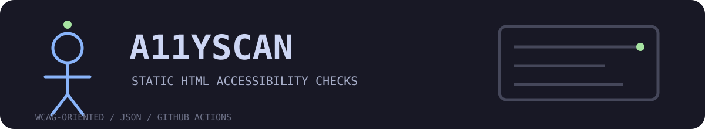

# A11yScan

<p align="center"></p>

**A zero-dependency static accessibility checker for HTML, with WCAG-oriented rules and CI output.**

A11yScan parses HTML with Python's standard-library `html.parser`. It does not run JavaScript, render CSS, or inspect the accessibility tree. Python 3.9+ is required; no pip installation is needed.

## Quick start

```bash
python a11yscan.py ./public
python a11yscan.py index.html about.html
```

Scan standard input:

```bash
cat index.html | python a11yscan.py -
```

## CI and reports

```bash
python a11yscan.py ./public --format json
python a11yscan.py ./public --format github
python a11yscan.py ./public --fail-on warning
python a11yscan.py --list-rules
```

Exit codes: `0` means no finding reached the selected severity, `1` means the threshold was reached, and `2` means invalid input or no HTML files were found.

Ignore selected rules for a run:

```bash
python a11yscan.py ./public --ignore A11Y008,A11Y022
```

The source also supports inline suppression comments using `a11yscan-ignore:` followed by rule IDs.

## Current coverage

The 22 rules cover image alternatives, document language/title, form labels, accessible names, heading structure, duplicate IDs, keyboard focus patterns, iframe titles, viewport zoom, table headers, autoplay, non-semantic click handlers, missing ARIA references, and a limited inline-style contrast estimate.

## Important limitations

This is a static heuristic checker, not a complete WCAG conformance test. It cannot reliably calculate computed styles, inspect external stylesheets, understand dynamic DOM updates, or replace keyboard and screen-reader testing. Contrast checks only work when foreground and background colors are explicitly parseable in the same inline style attribute. Always manually review findings and test with assistive technology.

## Development

```bash
python -m unittest discover -s tests -v
python -m py_compile a11yscan.py
```

## License

MIT. See [LICENSE](LICENSE).
